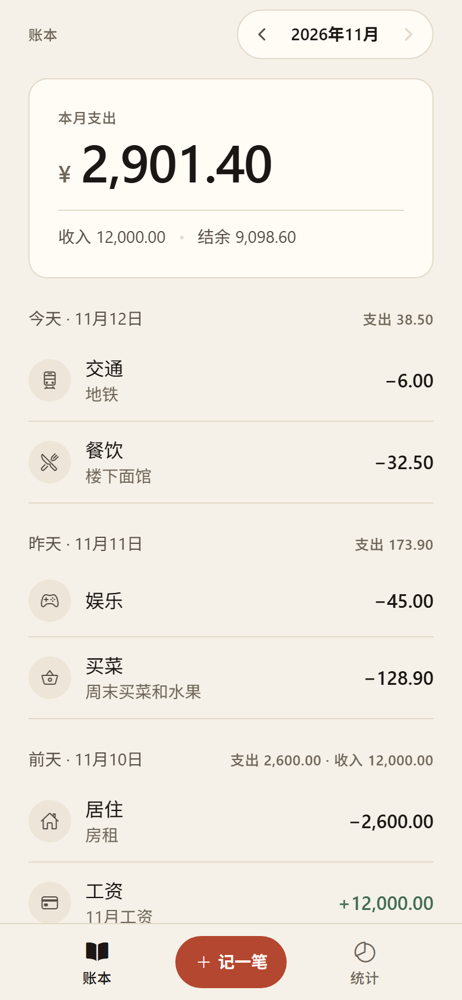
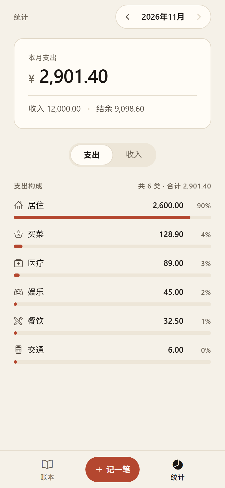
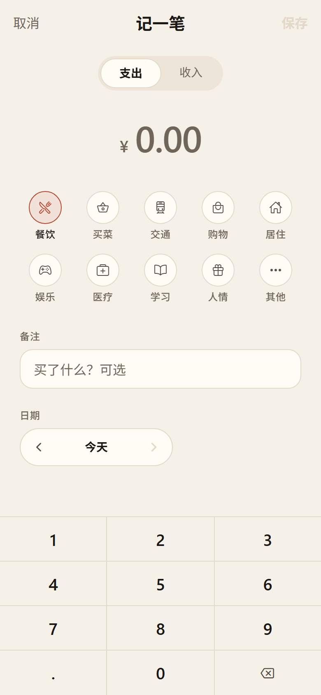
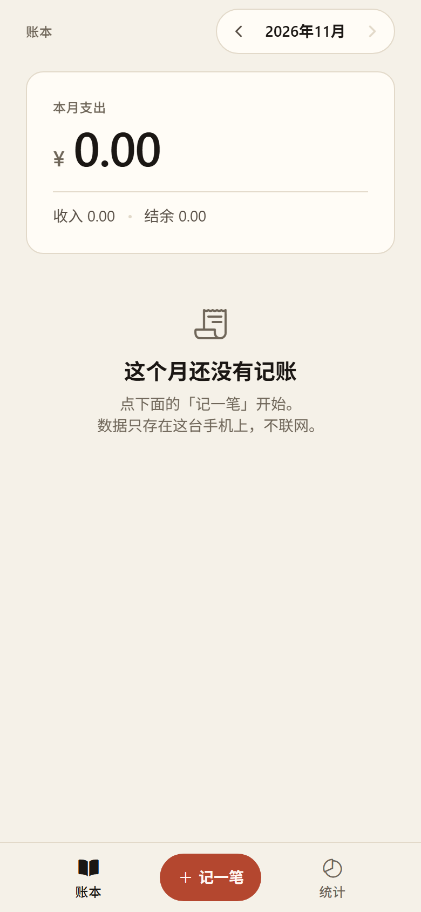

# 账本 · 日常记账

一个只给自己用的记账 App：记支出和收入、按月查看、按分类看占比。数据全部存在手机本地，不联网、不需要账号。

用 **Expo + React Native + TypeScript** 写的，源码在 Windows 上就能改，编译和签名交给云端 + Sideloadly，全程不需要 Mac。

| 账本（示例数据） | 统计 | 记一笔 |
|---|---|---|
|  |  |  |

第一次打开是空账本，长这样：



---

## 现在能做什么

- **记一笔**：数字键盘输入金额，**支持 `12.5 + 8 − 3`、`12.5 × 3`、`260 ÷ 3` 这样的算式**，先乘除后加减，实时算合计。键盘是 4×4 等大方格：左三列数字，右一列 `+ − × ÷`，底部退格。选分类，写备注，改日期（最远可往回翻到任意一天，最晚到今天）。
- **两类账**：支出 10 个分类（餐饮 / 买菜 / 交通 / 购物 / 居住 / 娱乐 / 医疗 / 学习 / 人情 / 其他），收入 5 个。
- **按月翻**：`‹ 2026年11月 ›`，标题上是本月支出大数字，下面是本月收入、结余。
- **按日分组**：同一天的账聚在一起，每天自己算小计。
- **统计**：本月支出 / 收入，按分类从大到小排，带比例条。
- **导出 PDF**：统计页底部一键把本月账目导成 A4 PDF —— 合计、分类占比条、按日明细（含当时输入的算式）全在里面，调起系统分享后可存到「文件」、发微信或打印。
- **改和删**：点任意一条记录进入编辑；删除要连点两次确认（不弹系统弹窗，误触不会丢东西）。列表上也可以左滑直接删，删完 5 秒内能撤销。
- **批量删除**：长按任意一行、或点账本页右上角的「选择」进入选择模式，勾几笔一起删；底部动作条有「全选」，删除后 8 秒内可整批撤销，顺序会还原到原位置。
- **导入截图账单**：在导入页点「从相册选截图」，支付成功页、点餐车、账本流水都能一次导入多笔，日期自动对上，重复的记录默认不勾选。文字识别用 iOS 自带的 Vision 框架，在本机跑，不联网、不上传、不保存图片。
- **离线**：AsyncStorage 本地存储，没有网络权限，不收集任何数据。

## 还没做的（想加再说）

导出 CSV、月度预算、自定义分类、iCloud 同步、密码锁、收支趋势曲线。

---

## 一、先在 iPhone 上看到它（10 分钟，零成本）

```bash
cd daily-ledger
npm install
npx expo start
```

1. iPhone 在 App Store 免费装 **Expo Go**。
2. 手机和电脑连同一个 Wi-Fi。
3. 用 iPhone 相机扫终端里的二维码。

改代码手机秒级刷新。这一步不需要签名、不需要开发者账号，先用它把功能验证掉。

> 注意：Expo Go 里没有原生模块，图标名也还是 Expo Go。要独立图标和独立 App，走下一步。

## 二、变成独立 App（免费签名，7 天有效）

### 1. 推上 GitHub，让云端编译

```bash
git add -A
git commit -m "first version"
git remote add origin https://github.com/<你的用户名>/daily-ledger.git
git push -u origin main
```

仓库里已经有 `.github/workflows/ios-unsigned.yml`，push 之后自动跑（Actions 免费额度：公开仓库不花钱）。

跑完在 Actions → 最新的 run → Artifacts 里下载 `Ledger-unsigned-ipa`，解压得到 `Ledger-unsigned.ipa`。

### 2. 在 Windows 上签名并安装

1. 装 **iTunes**（从 apple.com 下的经典版，**不要 Microsoft Store 版**）和 **iCloud for Windows**。
2. 装 **Sideloadly**（sideloadly.io）。
3. iPhone 插线，手机上点「信任此电脑」。
4. 把 `Ledger-unsigned.ipa` 拖进 Sideloadly，填 Apple ID + **App 专用密码**（在 appleid.apple.com 生成，比主密码安全）。
5. 点 Start。
6. iPhone：设置 → 隐私与安全性 → **开发者模式** 打开 → 重启。
7. 设置 → 通用 → **VPN与设备管理** → 信任你的证书。

### 3. 7 天后续签

免费账号签出来的 App 7 天后打不开（图标还在）。用同一个 ipa 再装一次即可，**bundle ID 不变，记账数据保留**。

想省事就换 **AltStore**（altstore.io + AltServer for Windows），同一 Wi-Fi 下自动续签，代价是它占一个免费 App 名额（免费账号总共只能有 3 个）。

---

## 三、改之前要知道的三件事

**1. 改包名**

`app.json` 里的 `com.yourname.ledger` 有两处（iOS 和 Android），换成你自己的。免费证书也要求 bundle ID 全局唯一，撞了会签名失败。

**2. 改完必须重新 push**

签名用的是云端编译出来的包，本地改完不 push，装上的还是旧版本。

**3. 云构建的 scheme 名字**

workflow 里写死了 `ios/Ledger.xcworkspace` 和 `-scheme Ledger`，它来自 `app.json` 的 `"name": "Ledger"`。**改 name 就要同步改 workflow**，否则构建找不到 target。想在手机上显示中文名，改 `ios.infoPlist.CFBundleDisplayName`（已经是「账本」），不用动 `name`。

---

## 四、数据存在哪

AsyncStorage，key 是 `daily-ledger/entries/v1`，一个 JSON 数组。

- 卸载 App 数据就没了。
- 重装（同 bundle ID 覆盖安装）数据还在。
- 想备份，最快的方式是在 `src/storage.ts` 里加一段导出到剪贴板的逻辑。

---

## 五、目录

```
App.tsx                     状态、持久化、页面切换
src/theme.ts                调色板 / 字号 / 间距 / 圆角（唯一的设计来源）
src/types.ts                类型 + 分类表
src/money.ts                金额格式化、日期计算、算式求值
src/storage.ts              AsyncStorage 读写
src/id.ts                   本地 id 生成
src/import/parse.ts         截图文字 → 账目（支付页 / 点餐车 / 流水三类）
src/ocr/index.ts            调用原生识别 + 可用性判断
src/ocr/lines.ts            把识别的零散坐标拼回「一行一段文字」（纯函数，可离线测）
src/pdf.ts                  月度账单 PDF（HTML → expo-print）
src/components/
  TabBar.tsx                底部三格：账本 / 记一笔 / 统计
  EntrySheet.tsx            记账弹层（金额键盘、分类、备注、日期、删除）
  ImportSheet.tsx           导入弹层（选图识别 / 粘贴文字 → 预览 → 勾选导入）
  Keypad.tsx                数字键盘（3 列数字 + 加减退格）
  KindSwitch.tsx            支出 / 收入 切换
  MonthStepper.tsx          月份切换
  SwipeRow.tsx              列表行左滑删除
src/screens/
  LedgerScreen.tsx          账本：本月总额 + 按日分组的流水 + 批量选择
  StatsScreen.tsx           统计：分类占比 + 导出 PDF
modules/ledger-ocr/         本地原生模块：Vision 文字识别（Swift，离线）
scripts/parse-check.ts      解析层自检（拿三张真实截图的文字跑）
.github/workflows/          云端编译出未签名 ipa
.github/workflows/          云端编译出未签名 ipa
```

## 六、改 UI 请沿用 token

设计方向是「纸质账簿」：暖白纸面、近黑油墨，**朱砂红只给主操作和当前选中态**。

- 颜色只用 `src/theme.ts` 里的 `palette`，不要新加十六进制值。
- 字号只有 6 个：`12 / 14 / 16 / 20 / 32 / 44`。要强调就换字号档位、换字重、换颜色，不要插中间值。
- 间距只用 4 的倍数：`4 / 8 / 12 / 16 / 24 / 32 / 48`。
- 圆角只有两个：卡片 `16`，药丸 `999`。
- 金额一律带 `num`（等宽数字），位数变化时不会抖。

---

## 七、常用命令

```bash
npm start          # Expo Go 里跑
npm run web        # 浏览器里看（只是预览，不是交付目标）
npm run typecheck  # tsc --noEmit
npm run check:parse # 解析层自检，不需要手机
```

## 八、导入截图里的账单

账本页标题右边的扫描图标（也支持 `ledger://import`）打开导入页，点**「从相册选截图」**选一张图，识别后直接进预览，勾选要的再导入。

识别用 iOS 系统自带的 Vision 框架，在本机完成，图片不上传、也不保存。这部分是原生代码，在 `modules/ledger-ocr/`（一个 Swift 文件 + podspec），由 `expo prebuild` 自动链接，CI 流程不用改。

三类图都认：

| 图 | 处理方式 |
|---|---|
| 支付成功页 / 账单详情 | 直接取「实付」金额，1 笔 |
| 点餐车 / 购物车 | 单价 × 数量求和；只算「已选 N 件」以下的部分，上面的推荐区不算 |
| 账本流水截图 | 日期是分组标题、向下继承；用「支出: 45」这类日汇总校验有没有漏读 |

日期没有年份时会推算：默认今年，落在未来就退一年，再用图上的「星期三」核对；核对不上会出告警，不硬猜。

分类先看图上有没有直接印着分类名（账本截图有），再看关键词表（星巴克、滴滴、美团这类）。都没命中的**默认归到「餐饮」**——截图导入的场景绝大多数是吃喝，落到「其他」反而要逐笔改；收入认不出时仍归「其他」。

### 没有相册识别时的两条退路

- **粘贴文字**：导入页下半部分那个输入框，直接把文字粘进去点「解析这段文字」。
- **快捷指令**：1. 新建捷径，加动作 **从图像提取文本**，输入选「剪贴板」或「最近的截图」；2. 加 **URL 编码**；3. 加 **打开 URL**：`ledger://import?text=` 接上一步的输出。之后截图 → 跑捷径，App 直接弹预览。

解析规则在 `src/import/parse.ts`，拼行规则在 `src/ocr/lines.ts`，用例在 `scripts/parse-check.ts`。`npm run check:parse` 会跑：点餐车必须算出 110 元、流水必须 7 笔共 146 元、支付页必须取到实付、模拟的识别坐标必须能拼回「11月11日 星期三 支出: 45」这样的行。
